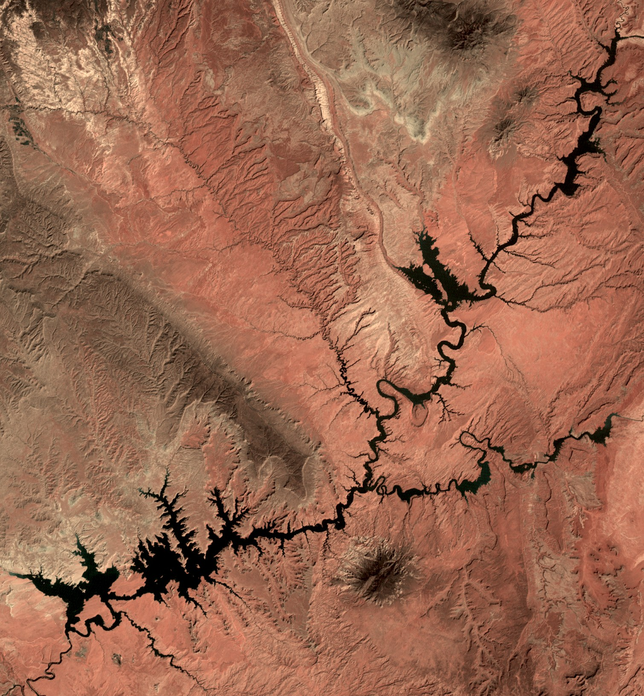
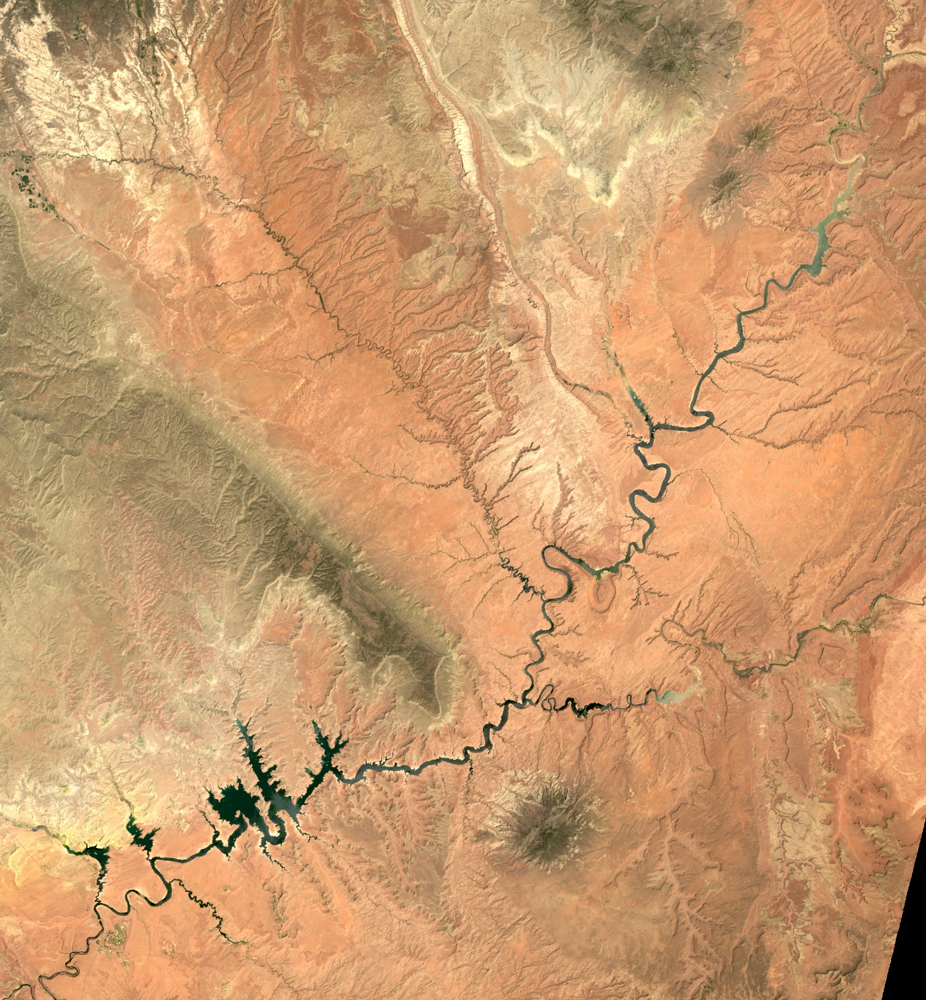

# Lake Powell Interactive Time Lapse Map

Watch Lake Powell fill and drain across **55 years of satellite imagery — every
year from 1972 to 2026** — from the first Landsat pass ever flown over Glen
Canyon to today's record-low reservoir.

**[▶ Use it in your browser](https://jsp244.github.io/lake-powell-interactive-time-lapse-map/)**
· **[⬇ Download the Windows app](../../releases/latest)** (no install, single exe)

| 1983 — full pool (3,700 ft) | 2026 — 178 ft lower |
|---|---|
|  |  |

## Features

- **Play the time lapse** (four speeds) or **scrub any individual year** with the
  slider / arrow keys
- **Zoom & pan** (scroll wheel + drag) — the view holds steady across years, so you
  can park on one bay and watch it drain
- **A/B compare** any two years with a draggable split-screen divider
  (1972 vs. today is startling)
- **Charts**: Bureau of Reclamation pool elevation 1963–present and
  imagery-derived water surface area 1984–present — hover for values, click to
  jump to a year
- Per-year detail: acquisition dates, satellite, cloud %, elevation, storage,
  water area

## The story in the data

Lake Powell began filling behind Glen Canyon Dam in 1963, first reached full pool
in 1980, and nearly overtopped its spillways in 1983. Since 2000 it has lost
roughly **170 vertical feet** and about **72% of its imaged water surface**
(543 km² in 1984 → 151 km² in June 2026).

## Run / rebuild it yourself

Everything regenerates from free, no-account public APIs:

```
pip install -r requirements.txt
python fetch_imagery.py      # ~1 min/year: picks the clearest summer Landsat
                             # scenes, mosaics them, renders frames/<year>.jpg
python fetch_elevation.py    # USBR daily elevation + storage since 1963
```

Then open `index.html` (works from `file://`, no server), or build the Windows
app:

```
pip install pywebview pyinstaller
python make_icon.py
pyinstaller --onefile --noconsole --icon lake.ico --name "Lake Powell Interactive Time Lapse Map" app.py
```

Next year, `python fetch_imagery.py` fetches only the missing year — the app and
page pick it up automatically, no rebuild needed.

## How it works

- **Imagery**: Landsat Collection 2 (USGS/NASA) via the
  [Microsoft Planetary Computer](https://planetarycomputer.microsoft.com/) STAC
  API. For each year the fetcher searches June–October scenes, groups them by
  acquisition date, reads the QA band at coarse resolution to score **cloud over
  the lake itself** (whole-scene cloud % lies), and mosaics adjacent WRS-2 scenes
  into one 75 m/px true-color frame with a fixed stretch so the lapse doesn't
  flicker.
- **1972–1983** use the primitive MSS sensor (60 m, no blue band — color is
  simulated, slightly rosier; 1982 took a year-round search because the early
  satellites were dying). MSS detector-dropout streaks masquerade as water, so
  physically impossible area readings trigger an automatic retry on different
  dates.
- **Water area**: MNDWI (green vs. shortwave-IR, haze-robust) on QA-clear pixels.
  Narrow canyon arms are sub-pixel at 75 m — treat it as a relative index. MSS-era
  radiometry is too crude for measurement, so those years show "n/a" and the area
  chart starts in 1984. 2012 is Landsat 7 (SLC-off striping, gap-corrected).
- **Elevation/storage**: Bureau of Reclamation UC hydrodata (site 919), daily
  since 1963, June–September mean per year. Full pool = 3,700 ft / 24.32 M
  acre-ft.

## Credits & license

Code: MIT. Imagery: USGS/NASA Landsat (public domain), served by Microsoft
Planetary Computer. Hydrology: U.S. Bureau of Reclamation (public domain).
Built with Claude Code.
